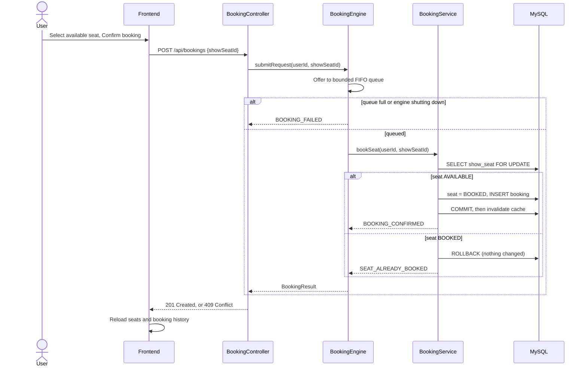
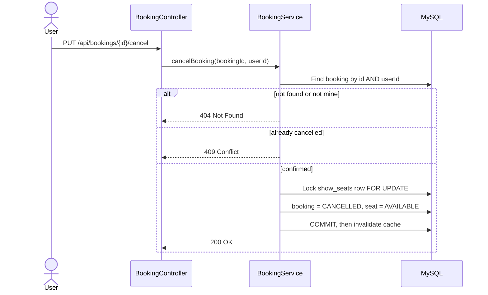

# CORE: Architecture

## 1. What the system is

CORE is a seat reservation system. A user picks an event, picks a show,
picks an available seat, and books it. Many users can try to book the
same seat at the same time. Only one of them must succeed.

## 2. Components

```mermaid
flowchart LR
    U[User in browser] -->|HTTP| FE[Static frontend<br/>index.html, app.js, style.css]
    FE -->|REST /api| SB[Spring Boot backend<br/>controllers, services]
    SB -->|queue| BE[BookingEngine<br/>bounded FIFO queue, 4 workers]
    BE --> BS[BookingService<br/>@Transactional]
    BS -->|pessimistic lock| DB[(MySQL core_db<br/>users, events, shows,<br/>seats, show_seats, bookings)]
    BS --> CA[SeatAvailabilityCache<br/>LRU, capacity 100]
    SB --> CA
```

| Component | Responsibility |
|---|---|
| Static frontend | Login/register forms, event and show selection, seat grid, booking, cancellation, booking history. Served by Spring Boot from `src/main/resources/static/`. No separate frontend server. |
| Controllers | Thin HTTP layer. `AuthController`, `EventController`, `ShowSeatController`, `BookingController`, `HealthController`. Controllers do not contain booking logic. |
| BookingEngine | Bounded FIFO queue (`ArrayBlockingQueue`, capacity 200, fair) and 4 fixed worker threads. Queue-full and shutdown submissions are rejected immediately, never silently dropped. |
| BookingService | The only place that changes a seat and creates a booking, inside one database transaction, under a pessimistic write lock on the `show_seats` row. |
| SeatAvailabilityCache | Read-only optimisation. LRU, 100 shows. Invalidated after a booking or cancellation commits, with a generation check so a slow database read cannot put stale seats back in the cache. The database, not the cache, decides whether a booking succeeds. |
| MySQL | The source of truth. `ddl-auto=validate`, so the schema is created by `db/schema.sql`, never by Hibernate. |

## 3. Booking flow



Key points for the viva:

- FIFO applies to the order requests leave the queue. Four workers run
  at the same time, so completion order is not FIFO.
- The lock is held only inside the transaction. Two requests for the
  same seat serialise on the row lock; the second one sees BOOKED and
  is rejected. No booking row is created for it.
- A duplicate is therefore impossible through the normal path even
  without a database unique constraint. There is no unique index on
  `bookings` in this project, because a seat is booked again after a
  cancellation and the cancelled booking must stay recorded. A unique
  index on `show_seat_id` alone would forbid that. See `db/schema.sql`.

## 4. Cancellation flow



Only the owner can cancel a booking. Cancellation is also a
transaction, so the seat and the booking can never disagree.

## 5. Cache flow

```mermaid
flowchart TD
    A[GET /api/shows/{id}/seats] --> B{Cache hit?}
    B -->|Yes| C[Return cached seats]
    B -->|No| D[Record generation]
    D --> E[Read seats from database]
    E --> F{Generation changed<br/>while reading?}
    F -->|Yes| G[Do not cache, return seats]
    F -->|No| H[Cache seats, return seats]
    I[Booking / cancellation commits] --> J[Invalidate show, generation++]
```

## 6. Security

- Passwords are stored as BCrypt hashes, never in plain text.
- Protected endpoints use HTTP Basic authentication.
- `GET /api/events`, `GET /api/events/{id}/shows`,
  `GET /api/shows/{id}/seats` and the static pages are public.
- `POST /api/bookings`, `GET /api/bookings/my` and
  `PUT /api/bookings/{id}/cancel` require a signed-in user.
- `/api/admin/**` requires the ADMIN role.
- Booking history and cancellation are always scoped to the
  signed-in user; a user cannot see or cancel another user's booking.

## 7. Configuration

- `spring.datasource.url=jdbc:mysql://localhost:3306/core_db`
- Credentials come from `DB_USERNAME` and `DB_PASSWORD` environment
  variables. No password is stored in the repository.
- `spring.jpa.hibernate.ddl-auto=validate`
- Booking engine: 4 workers, queue capacity 200
  (`BookingEngineConfig`).
